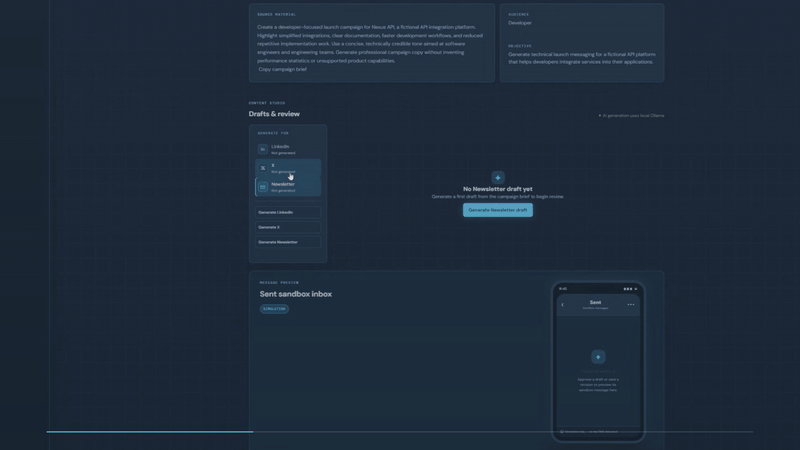

# Content-to-Campaign Pipeline

> A small, end-to-end content operations workspace for turning source material into platform-specific drafts, revisions, approvals, and Sent notifications.

[Live demo](https://content-to-campain.vercel.app/)



## Overview

This project explores a practical question: what would a lightweight content workflow look like if the campaign brief, AI generation, human review, and operational notification lived in one place?

The result is a React/TypeScript frontend backed by a FastAPI service. A user can create a campaign from source material, define an audience and objective, generate a draft for LinkedIn, X, or a newsletter, edit the draft, approve it, and trigger a sandbox notification through Sent's messaging API.

The implementation is intentionally small and inspectable. It demonstrates API integration, product thinking, technical writing, UX judgment, and a feedback loop between content creation and workflow state—the same intersection this project was built to explore for a Content Engineer role.

## Product flow

```text
Campaign brief
    │
    ▼
Generate platform-specific draft ──► Ollama locally or OpenAI
    │
    ▼
Edit and save revision
    │
    ▼
Approve draft ──► Send sandbox notification through Sent
```

### What the UI supports

- Create campaigns with a name, source material, target audience, and objective.
- Browse campaigns and inspect their source context.
- Generate one draft at a time for LinkedIn, X, or newsletter content.
- Edit drafts in place and track revision numbers.
- Approve a draft once it is ready for the next step.
- Show API health and notification state in the workspace.
- Preview the approved-content notification experience in the phone simulator.

## Architecture

```text
React + TypeScript + Vite
        │ JSON over HTTP
        ▼
FastAPI application
   ┌────┼───────────────┐
   ▼    ▼               ▼
SQLite  AI provider     Sent DM API
        Ollama/OpenAI   sandbox notifications
```

### Frontend

- React 19 with TypeScript
- Vite for development and production builds
- A small typed API client in `frontend/src/api.ts`
- CSS-based workspace UI with campaign overview, content studio, editor, and phone simulator
- `VITE_API_BASE_URL` controls which backend the deployed frontend calls

### Backend

- FastAPI application in `backend/main.py`
- SQLite persistence in `backend/campaigns.db`
- Pydantic request validation for campaign and draft inputs
- Provider switch for local Ollama or OpenAI generation
- Sent DM sandbox notifications for new, revised, and approved drafts
- Thread-safe sliding-window rate limiting for generation and write operations

## API surface

| Method  | Route                                   | Purpose                            |
| ------- | --------------------------------------- | ---------------------------------- |
| `GET`   | `/api/health`                           | Confirm the API is available       |
| `GET`   | `/api/campaigns`                        | List campaigns                     |
| `POST`  | `/api/campaigns`                        | Create a campaign                  |
| `GET`   | `/api/campaigns/{campaign_id}`          | Retrieve one campaign              |
| `GET`   | `/api/campaigns/{campaign_id}/drafts`   | List campaign drafts               |
| `POST`  | `/api/campaigns/{campaign_id}/drafts`   | Create a manual draft              |
| `POST`  | `/api/campaigns/{campaign_id}/generate` | Generate a platform-specific draft |
| `PATCH` | `/api/drafts/{draft_id}`                | Save a revision and notify Sent    |
| `POST`  | `/api/drafts/{draft_id}/approve`        | Approve once and notify Sent       |

Generation accepts only `linkedin`, `x`, or `newsletter`. The backend prompt also constrains the model to facts present in the campaign source material and asks it to return exactly one finished piece of content.

## Local setup

### 1. Start the backend

```bash
cd backend
python -m venv .venv

# macOS/Linux
source .venv/bin/activate

# Windows PowerShell
.\.venv\Scripts\Activate.ps1

pip install -r requirements.txt
copy .env.example .env  # Windows
# cp .env.example .env  # macOS/Linux
uvicorn main:app --reload
```

The API runs at `http://localhost:8000`. The SQLite database is initialized automatically when the application starts.

### 2. Configure generation and notifications

Edit `backend/.env`:

```dotenv
AI_PROVIDER=ollama
OLLAMA_URL=http://localhost:11434/api/generate
OLLAMA_MODEL=gemma4:e4b

# Required for Sent sandbox notifications
SENT_DM_API_KEY=your_sandbox_key_here
SENT_TEMPLATE_ID=your_template_id
SENT_TEST_PHONE=+15555555555
```

Ollama is the default local provider. To use OpenAI instead, set `AI_PROVIDER=openai`, provide `OPENAI_API_KEY`, and optionally set `OPENAI_MODEL`.

### 3. Start the frontend

In a second terminal:

```bash
cd frontend
npm install
npm run dev
```

The frontend runs at the Vite URL, normally `http://localhost:5173`. For a separately hosted backend, set `VITE_API_BASE_URL` in `frontend/.env` before building:

```dotenv
VITE_API_BASE_URL=https://your-api.example.com
```

## Verification

Backend tests can be run from the backend directory:

```bash
cd backend
python -m unittest discover -s . -p "test_*.py"
```

Frontend checks and production build:

```bash
cd frontend
npm run lint
npm run build
```

## Design and engineering decisions

### Keep the content loop human-in-the-loop

Generation creates a draft, not a published post. Every draft is editable, revisioned, and explicitly approved. This keeps the model useful without treating generated copy as automatically publishable.

### Make platform constraints explicit

The API validates the supported platform values, while the generation prompt gives each platform a distinct output rule. That keeps the workflow predictable and prevents a single request from producing a bundle of unfocused alternate drafts.

### Treat messaging as an operational integration

Sent is used at workflow boundaries: a new draft is ready, a revision was saved, or a draft was approved. Notifications are sent with `sandbox=True`, and the response status/message ID is stored so the UI can show what happened without making delivery claims it cannot verify.

### Add guardrails around expensive or state-changing actions

Generation is limited to three requests per client per 24-hour window by default. Draft writes are limited to twenty per client per minute. Rate-limited responses include `Retry-After` and `X-RateLimit-*` headers so a client can respond intentionally.

## Security and Demo Limitations

This is a public, unauthenticated portfolio demo. Campaigns and drafts are publicly reachable through the API, and a caller who discovers the backend can directly create, read, modify, generate, or approve records. CORS and frontend controls are not authentication or authorization.

The backend applies best-effort, in-process, per-client-IP rate limits to generation and state-changing writes. These limits are configurable and are not a substitute for shared abuse protection in a multi-instance deployment.

Generation treats campaign fields as untrusted reference material and keeps approval, persistence, and Sent notification decisions in backend code. Prompt-injection instructions can still influence model output; the mitigations reduce risk but do not eliminate it. Generated output and user inputs are bounded and validated before persistence.

Sent notifications are sandbox-only. This project does not publish content or send live messages. Do not use sensitive data with the public demo. A real deployment would require authentication, authorization, stronger abuse controls, managed persistence, and an additional security review.
